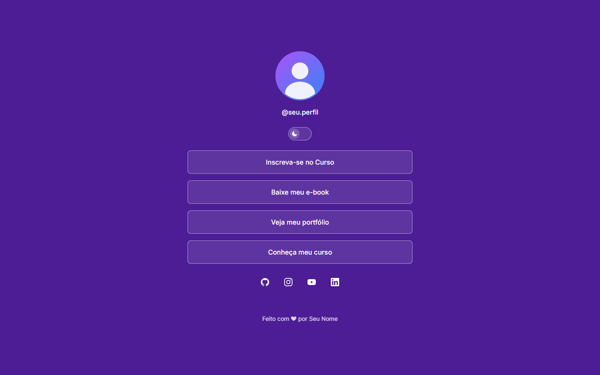
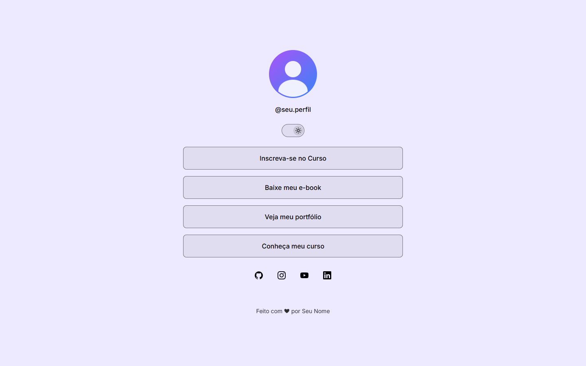
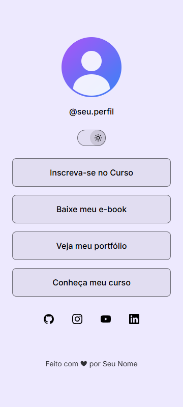
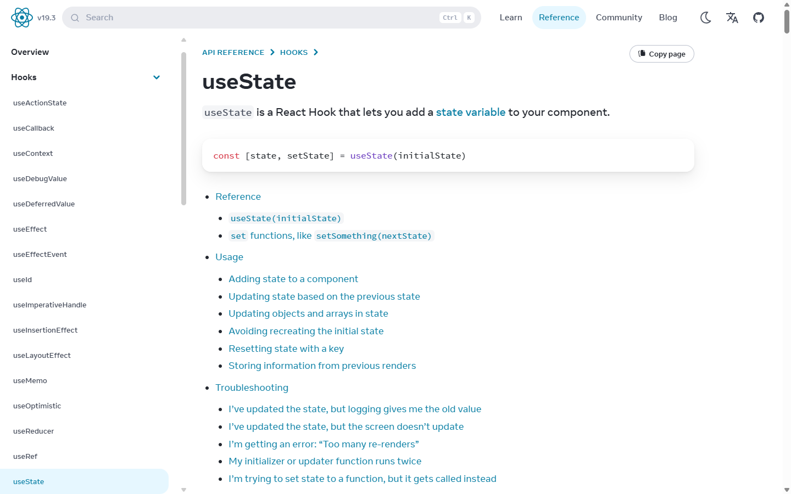
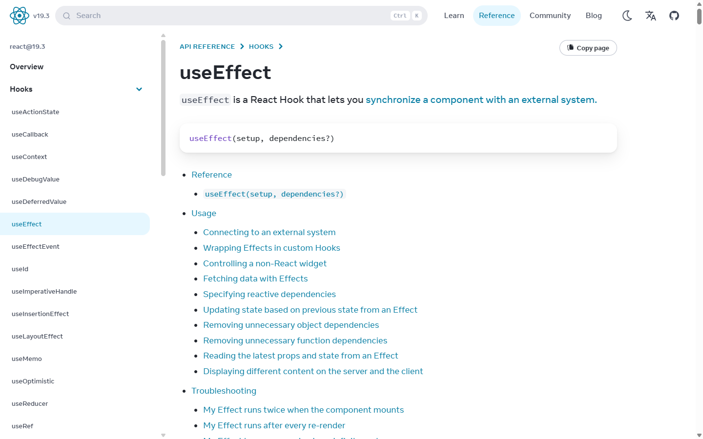
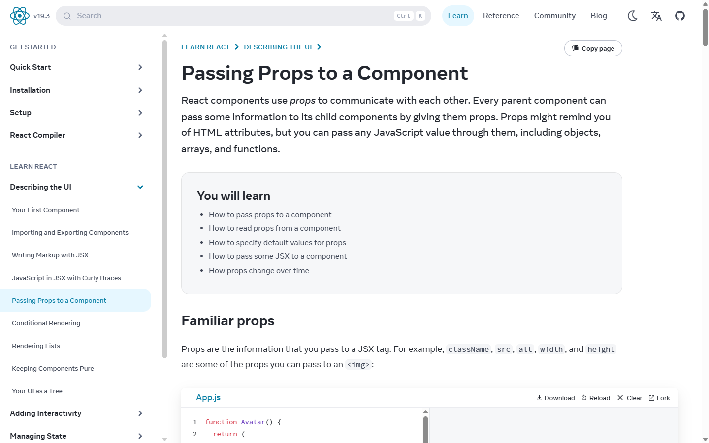
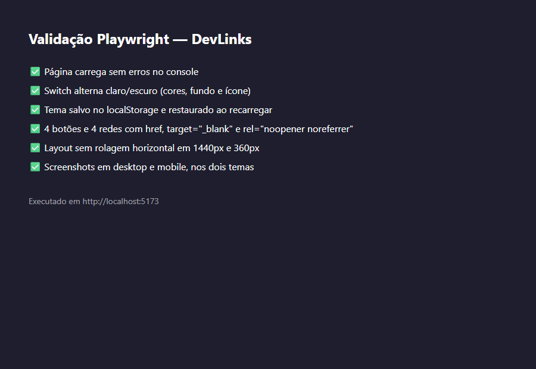

# DevLinks

Página de links pessoais (estilo "link na bio") com avatar, @usuário, tema claro/escuro, botões de link e redes sociais.

## Tecnologias

- **React** + **Vite**
- **CSS** com variáveis (tokens) e layout responsivo (mobile-first)
- **Inter** (Google Fonts)
- Ícones SVG inline (lua/sol e redes sociais)
- **OpenCode** com `AGENTS.md`
- **Context7 MCP** para consultar a documentação oficial do React
- **Playwright MCP** para validação e screenshots

## Instalação e execução

```bash
npm install
npm run dev
```

Abra [http://localhost:5173](http://localhost:5173).

## Funcionalidades

- Tema claro/escuro com troca pelo switch, salvo no `localStorage`.
- 4 botões de link e 4 redes sociais gerados com `map()`.
- Layout responsivo: mobile (360px) e desktop (1440px), sem rolagem horizontal.
- HTML semântico e acessível (`alt`, `aria-label`, `aria-pressed`).

## Capturas de tela

### Desktop

| Escuro | Claro |
| --- | --- |
|  |  |

### Mobile

| Escuro | Claro |
| --- | --- |
|  |  |

## Uso de IA

O projeto foi desenvolvido com o **OpenCode**, seguindo as regras do `AGENTS.md`. O **Context7 MCP** foi usado para consultar a documentação oficial do React (`useState`, `useEffect`, Props) antes de implementar, e o **Playwright MCP** para validar layout, links, troca de tema e persistência.

### Context7 — documentação consultada





### Playwright — validação


